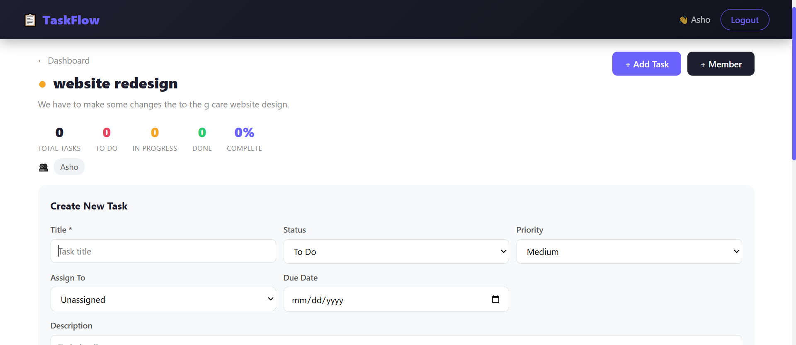

# TaskFlow — Project Management Tool

MERN project management app with a Kanban board, task assignment, comments and real-time updates using Socket.io.



## Features

- User registration and login with JWT authentication
- Create and manage multiple projects, with color-coded cards
- Add and remove team members on a project
- Kanban board with three columns: To Do, In Progress, Done
- Drag and drop tasks between columns
- Edit task details after creation
- Task priority levels (Low, Medium, High) and due dates
- Overdue task highlighting
- Assign tasks to project members
- Comments on every task
- Project progress bar and task stats
- Real-time task and member updates with Socket.io

## Tech Stack

| Layer | Technologies |
|---|---|
| Frontend | React (Vite), React Router DOM, Axios, Socket.io Client, Context API |
| Backend | Node.js, Express.js, MongoDB Atlas, Mongoose |
| Auth | JWT, bcrypt |
| Real-time | Socket.io |

## Project Structure

```
taskflow/
├── backend/
│   ├── src/
│   │   ├── config/        # db.js
│   │   ├── models/        # user, project, task, comment
│   │   ├── controllers/   # auth, project, task, comment
│   │   ├── routes/        # auth, project, task, comment
│   │   └── middleware/    # authMiddleware
│   ├── .gitignore
│   ├── package.json
│   └── server.js
├── frontend/
│   └── src/
│       ├── components/    # Navbar, TaskCard
│       ├── pages/         # Login, Register, Dashboard, Project
│       ├── context/       # AuthContext
│       ├── services/      # api.js
│       ├── App.jsx
│       └── main.jsx
├── demo.png
└── README.md
```

## Run Locally

**Requirements:** Node.js (LTS) and a MongoDB Atlas connection string.

```bash
# 1. Clone the repository
git clone https://github.com/ash-1212/CodeAlpha_ProjectManagementTool.git
cd CodeAlpha_ProjectManagementTool
```

**Backend** (first terminal)

```bash
cd backend
npm install
```

Create a `.env` file inside `backend/`:

```
PORT=5000
MONGO_URI=your_mongodb_atlas_connection_string
JWT_SECRET=your_jwt_secret_key
```

```bash
npm run dev
```

**Frontend** (second terminal)

```bash
cd frontend
npm install
npm run dev
```

Open the link shown in the terminal (usually http://localhost:5173).

## Environment Variables

| Variable | Description |
|---|---|
| PORT | Port for the backend server |
| MONGO_URI | MongoDB Atlas connection string |
| JWT_SECRET | Secret key used to sign JWT tokens |

Never commit your `.env` file.

## Database Schema

**Users:** name, email, password (hashed), avatar, createdAt

**Projects:** title, description, color, owner (ref User), members [ref User]

**Tasks:** title, description, status, priority, project (ref), assignee (ref), createdBy (ref), dueDate

**Comments:** text, task (ref), user (ref), createdAt

## API Endpoints

### Auth

| Method | Endpoint | Description |
|---|---|---|
| POST | /api/auth/register | Register |
| POST | /api/auth/login | Login |

### Projects

| Method | Endpoint | Description |
|---|---|---|
| GET | /api/projects | Get my projects |
| POST | /api/projects | Create project |
| GET | /api/projects/:id | Get project |
| DELETE | /api/projects/:id | Delete project |
| POST | /api/projects/:id/members | Add member |
| DELETE | /api/projects/:id/members/:memberId | Remove member |

### Tasks

| Method | Endpoint | Description |
|---|---|---|
| GET | /api/tasks/project/:id | Get project tasks |
| POST | /api/tasks | Create task |
| PUT | /api/tasks/:id | Update task |
| DELETE | /api/tasks/:id | Delete task |

### Comments

| Method | Endpoint | Description |
|---|---|---|
| GET | /api/comments/:taskId | Get comments |
| POST | /api/comments/:taskId | Add comment |
| DELETE | /api/comments/:id | Delete comment |

## Real-Time Events (Socket.io)

| Event | Description |
|---|---|
| joinProject | User joins a project room |
| taskCreated | New task appears for all members |
| taskUpdated | Task changes are visible to all members |
| taskDeleted | Task is removed for all members |
| memberAdded | Project updates when a member joins |

## Future Improvements

- File attachments on tasks
- Task labels and tags
- Activity log per project
- Email notifications
- Dark mode
- Deployment (Render and Vercel)

## Author

**Ayesha Nazish**
Built during the CodeAlpha Full Stack Development Internship (Task 3).
[GitHub](https://github.com/ash-1212) · [LinkedIn](https://www.linkedin.com/in/ayeshanazish-452048274)
